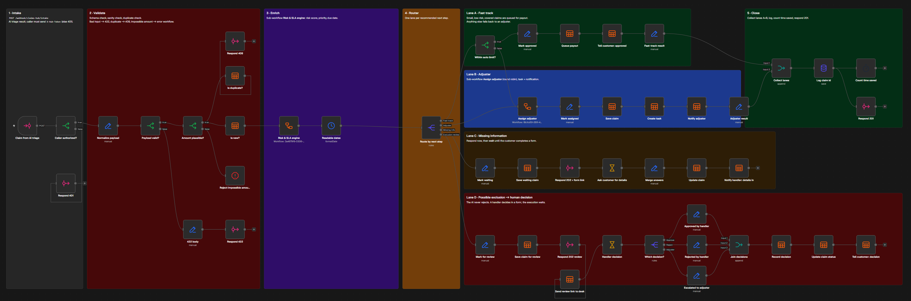
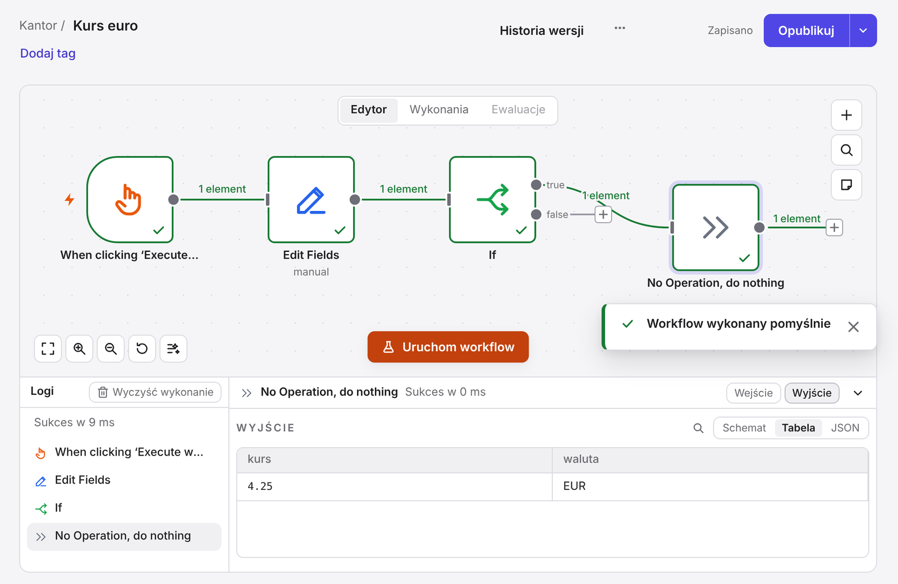
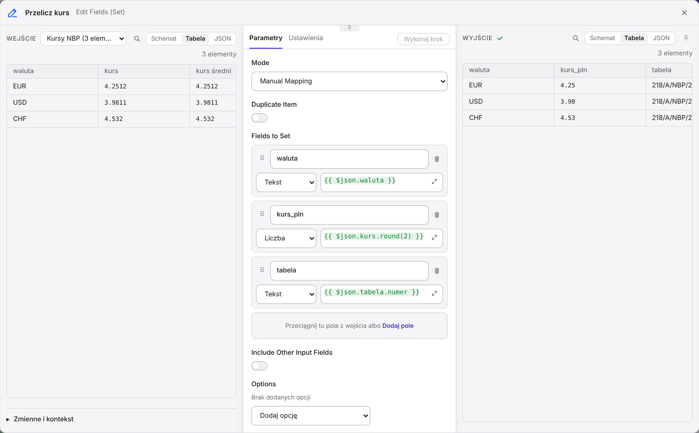
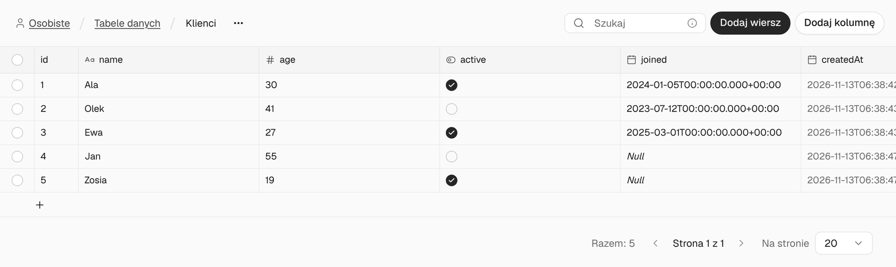
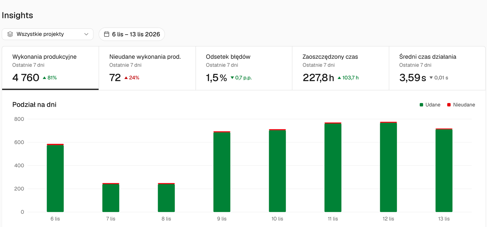
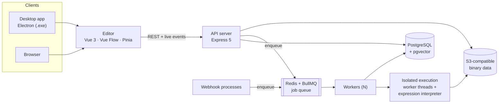
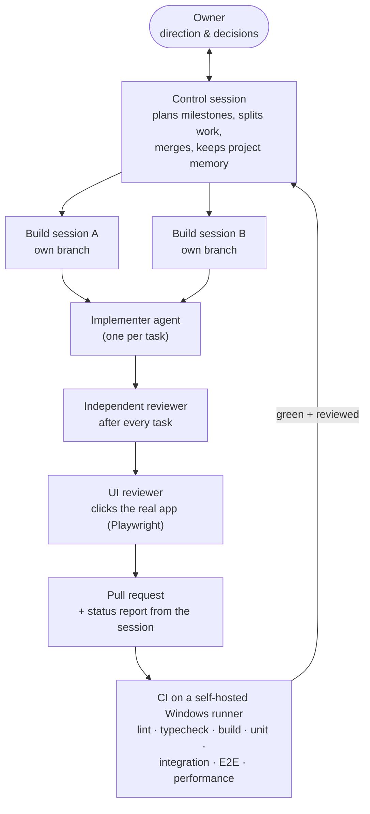

# AI engineering showcase: Solvon + a GenAI claims assistant

This repository has three parts:

1. **[`automations/`](automations/)** — **Claims Operations Hub**: 7 connected workflows (102 nodes) built and run in
   Solvon — webhooks, public forms, human-in-the-loop waits, sub-workflows, schedules, error handling, data tables.
2. **[`claims-assistant/`](claims-assistant/)** — an open-source (MIT) Python demo written for this repo:
   a GenAI assistant that triages insurance claims, with RAG, an agent, evaluation and LLMOps. It feeds the hub.
3. **Solvon** — a platform for building AI agents and workflow automations that I am building with a team of
   AI agents. Its source is private; this page describes what it does and how it is built.

[](automations/)

<sub>The main workflow of the Claims Operations Hub on the Solvon canvas — [details, run data and the other 6 workflows](automations/).</sub>

## Highlights

| | |
|---|---|
| **Workflow automation** | 7 workflows, 25 node types: validation with 422/409, a 4-lane router, round-robin assignment, SLA escalation in batches, daily KPIs, a global error workflow ([automations/](automations/)) |
| **Human in the loop** | Executions answer `202` at once and **wait for a form** — customer details or a handler's decision — then continue |
| **Automation as code** | The whole hub is generated from Python and deployed through Solvon's REST API, idempotently ([hub.py](automations/hub.py), [deploy.py](automations/deploy.py)) |
| **RAG with citations** | Policy terms chunked by clause; `Retriever` interface with local BM25 and **Azure AI Search** ([retrieval.py](claims-assistant/src/claims_assistant/retrieval.py)); every answer quotes its sources |
| **AI agent** | Tool-calling loop (`search_policy`, `check_coverage`, `estimate_payout`) with step limit, per-step trace and deterministic guardrails ([agent.py](claims-assistant/src/claims_assistant/agent.py)) |
| **Azure OpenAI** | `LLMClient` on the official `openai` SDK, API key or keyless Entra ID; offline stand-in so everything runs without keys ([llm.py](claims-assistant/src/claims_assistant/llm.py)) |
| **Prompt engineering** | Versioned system prompt with an explicit JSON contract and injection handling ([prompts.py](claims-assistant/src/claims_assistant/prompts.py)) |
| **Evaluation** | Labelled set, task metrics, groundedness, retrieval hit rate, PII-leak check, optional LLM-as-judge ([evals/](claims-assistant/evals/)) |
| **MLflow** | Every eval run logs params, metrics and per-case results; thresholds fail CI |
| **REST integration** | FastAPI: synchronous assessment and an asynchronous job API (202 + polling) |
| **LLMOps** | Docker (non-root), docker compose with an MLflow server, **Kubernetes** manifests with probes and workload identity, GitHub Actions |
| **AI governance** | PII masking (PESEL, IBAN, …), audit log without direct identifiers, [model card](claims-assistant/docs/model-card.md), [EU AI Act assessment](claims-assistant/docs/ai-act.md) |
| **Agent orchestration at scale** | Solvon itself is built by coordinated Claude agents with review and CI gates — [below](#how-solvon-is-built-with-ai) |

```bash
cd claims-assistant
make install && make test && make eval   # offline: no keys, no cloud
```

The AI and the automation are connected: `automations/traffic.py` runs each claim through the claims assistant and
posts its assessment to the hub's webhook, where Solvon takes over the process.

---

## Solvon

**Solvon** is a platform for building AI agents and workflow automations for small businesses,
compatible with the n8n workflow format. It is under active development; the product source is private.

### What works today

Milestones M0–M4 are done and M5 is in its final review (27 Oct – 20 Nov 2026, about 3.5 weeks).

| Area | What is in place |
|---|---|
| Accounts & projects | Sign-up, 2FA, API keys, public REST API; projects with per-project data isolation |
| Workflows | Versions and version history, publishing, folders, tags, variables, import |
| Nodes | About 30 core nodes: If, Switch, Merge, Filter, Sort, Aggregate, Wait, sub-workflows, error triggers, … |
| Execution engine | Runs workflows node by node; expressions go through **an own expression interpreter** (parser + AST walker, no `eval`); execution history |
| Isolation | Executions run in worker threads with resource limits |
| Editor | Canvas editor with node groups, sticky notes and a command palette; node details panel with input/output preview; expression editor with autocomplete; pinned data; execution logs |
| Triggers | Webhooks, forms, schedules |
| Scale-out | Queue mode: main process, N workers and separate webhook processes on Redis + BullMQ |
| Data | Data Tables (typed columns, filters, CSV import) and a node to read/write them from workflows |
| Monitoring | Insights: executions, failure rate, time saved, average run time per day and per workflow |

**Planned next:** AI inside workflows (LLM and agent nodes), a dedicated AI agent builder, MCP client and server,
and the Windows desktop app (an Electron shell already exists).

<table>
  <tr>
    <td></td>
    <td></td>
  </tr>
  <tr>
    <td align="center"><sub>Workflow canvas after a successful run, with per-node logs</sub></td>
    <td align="center"><sub>Node details: input data, expression parameters, output</sub></td>
  </tr>
  <tr>
    <td></td>
    <td></td>
  </tr>
  <tr>
    <td align="center"><sub>Data Tables with typed columns</sub></td>
    <td align="center"><sub>Insights (sample data)</sub></td>
  </tr>
</table>

<sub>Screenshots from the test environment with sample data; the UI is in Polish.</sub>

### Architecture



Cloud-ready from day one: configuration through environment variables, one Docker image for the API,
workers and webhook processes, and Docker Compose for the local stack (PostgreSQL, Redis, S3-compatible
storage, a mail catcher).

**Stack:** TypeScript · Node 24 · pnpm + Turborepo monorepo (9 packages) · Express 5 · TypeORM · PostgreSQL (pgvector) ·
Redis + BullMQ · Vue 3 + Vue Flow · Electron · Vitest · Playwright · Biome · Docker Compose · GitHub Actions.

### How Solvon is built with AI

The whole codebase is written by Claude agents. My role is that of a tech lead and product owner:
I set direction, make decisions and review; the agents plan, implement, test and review each other.



- **Planning without collisions.** A control session turns each milestone into a written plan with tests,
  then splits it into sessions and sub-sessions that never edit the same files, so they can run in parallel.
  The next milestone starts only when the previous one is fully closed (tasks, hand-offs, CI, review).
- **Model per job.** The most capable model for planning and splitting work, a strong coding model at high effort
  for implementation and every review, a fast model for small jobs.
- **Implement → review loop.** Each task gets a fresh implementer agent and then an independent reviewer that
  did not write the code. Screens are reviewed by an agent that drives the running app in a browser.
- **Hard gates, not trust.** Every PR is checked before merge on a self-hosted Windows runner: Biome lint,
  TypeScript typecheck, build, unit tests, integration tests against fresh PostgreSQL and Redis, Playwright E2E,
  and performance tests of the editor with a 300-node workflow. Only green, reviewed PRs get merged.
- **Compatibility as an eval.** Behaviour is checked against **537 reference outputs recorded from a reference
  engine running locally in Docker** — the agents' code has to produce the same results, not just pass its own tests.
- **Memory in the repo.** Plans, milestone status, decisions and a change log live in the repository. A hook
  re-injects the control session's state after every restart or context compaction, and cloud sessions
  report progress as structured comments in their PRs — so no context lives only in one chat.

| Numbers | |
|---|---|
| Time span | 27 Oct – 20 Nov 2026 |
| Commits on `main` | 796 |
| Pull requests | 28 opened, 25 merged (the PR workflow started on 29 Oct) |
| Unit tests | 7,575 |
| Integration tests | 1,701 (fresh PostgreSQL and Redis) |
| E2E tests (Playwright) | 59 |
| Performance tests | 10 (editor with a 300-node workflow) |
| Compatibility reference outputs | 537 |

<sub>Test counts: CI run on `main` at commit 130d6a6 (20 Nov 2026). Commits and PRs: git history and GitHub, 20 Nov 2026.</sub>

## License

The code in [`claims-assistant/`](claims-assistant/) is MIT-licensed ([LICENSE](LICENSE)).
The Solvon product itself — its source code, plans and design — is private and not covered by this license.

---

## Po polsku

**`automations/`** to „Claims Operations Hub” — 7 połączonych workflowów (102 węzłów) zbudowanych i uruchomionych
w Solvonie: webhook z walidacją, router na 4 tory, formularze, na które wykonanie czeka (decyzja likwidatora,
dane od klienta), podworkflowy, harmonogramy (eskalacja SLA, dzienne KPI), globalny workflow błędów i tabele danych.
Cały system jest zapisany jako kod w Pythonie i wgrywany przez REST API Solvona.

Pozostałe części repozytorium: **`claims-assistant/`** to otwarte (MIT) demo w Pythonie: asystent GenAI do wstępnej
oceny zgłoszeń szkód — RAG z cytatami z warunków ubezpieczenia (lokalnie BM25 albo Azure AI Search), agent
z narzędziami na Azure OpenAI, ewaluacja z progiem jakości w CI i zapisem do MLflow, FastAPI, Docker, Kubernetes,
maskowanie danych osobowych, dziennik audytu, karta modelu i analiza AI Act. Wszystko działa bez kluczy.

**Solvon** to platforma do budowy agentów AI i automatyzacji dla małych firm, kompatybilna z formatem workflowów n8n.
Jest w budowie, a jej kod jest prywatny. Cały kod piszą agenci Claude — sesja sterująca planuje i dzieli pracę,
sesje budujące pracują na gałęziach z niezależnym recenzentem po każdym zadaniu, a każdy PR przed połączeniem
przechodzi przez automat na Windows (lint, typy, testy jednostkowe, integracyjne, E2E i wydajności).
