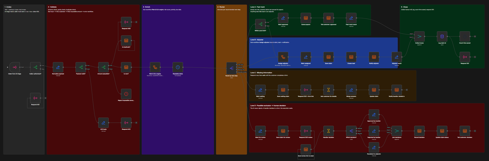
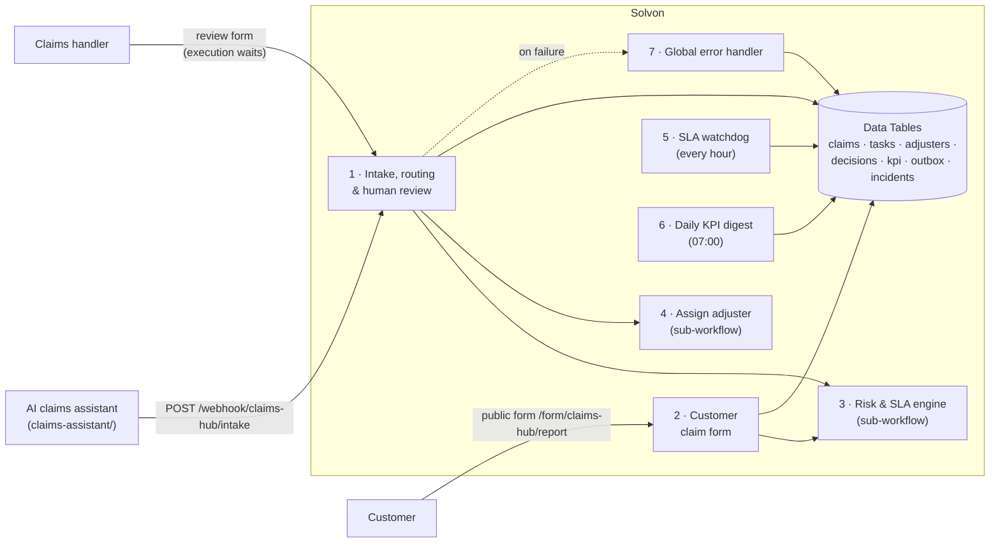
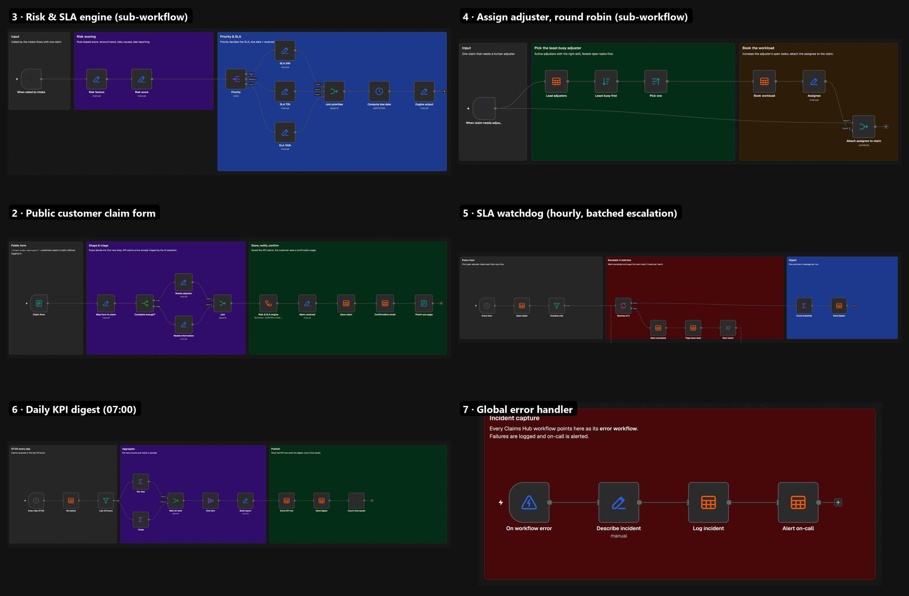
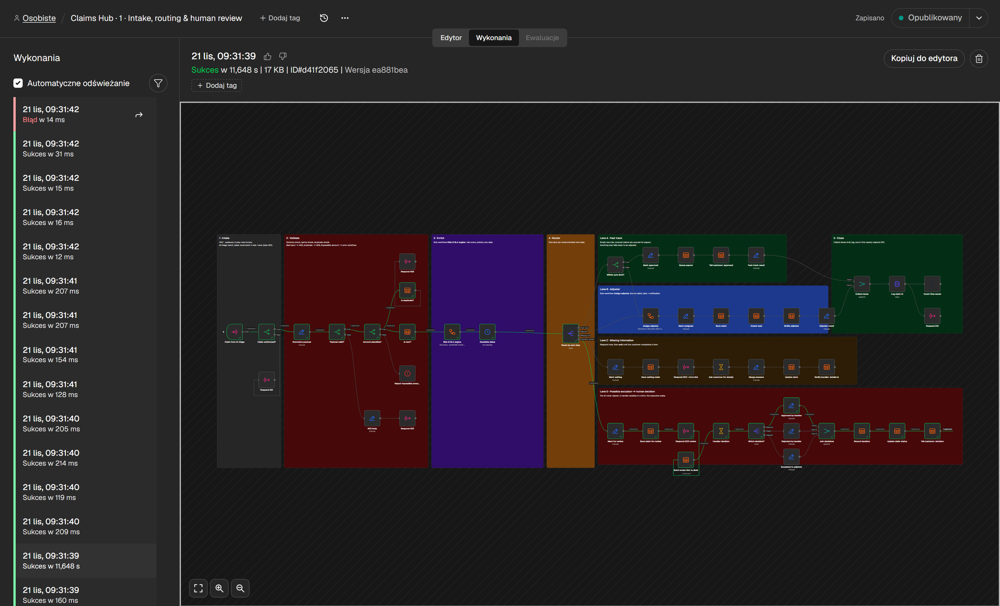
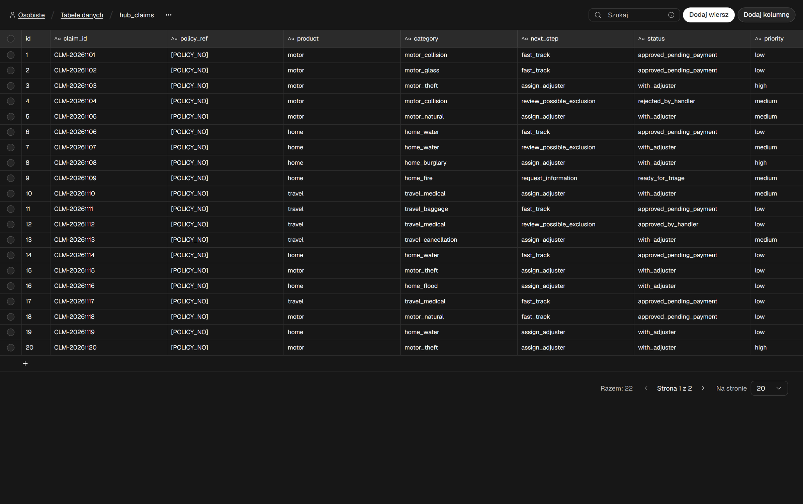
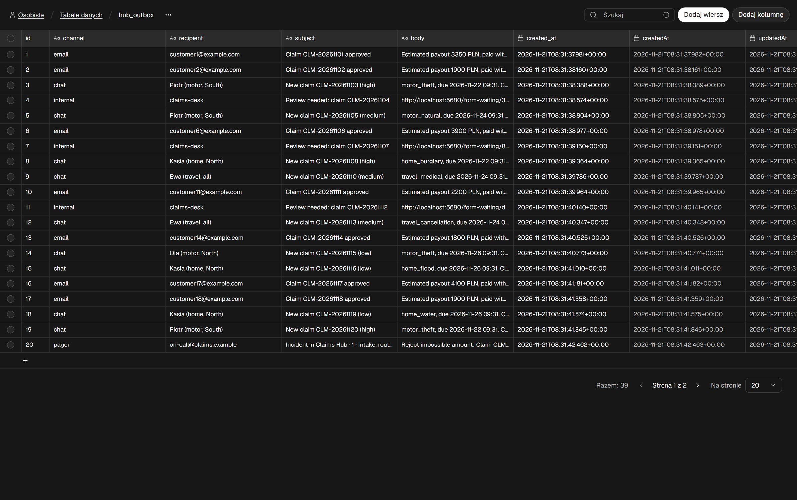
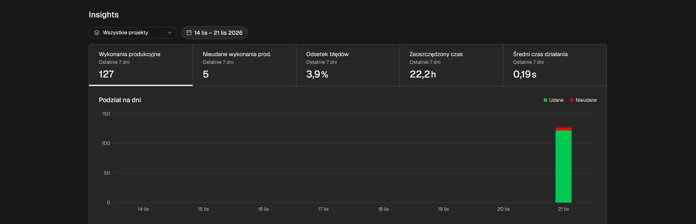
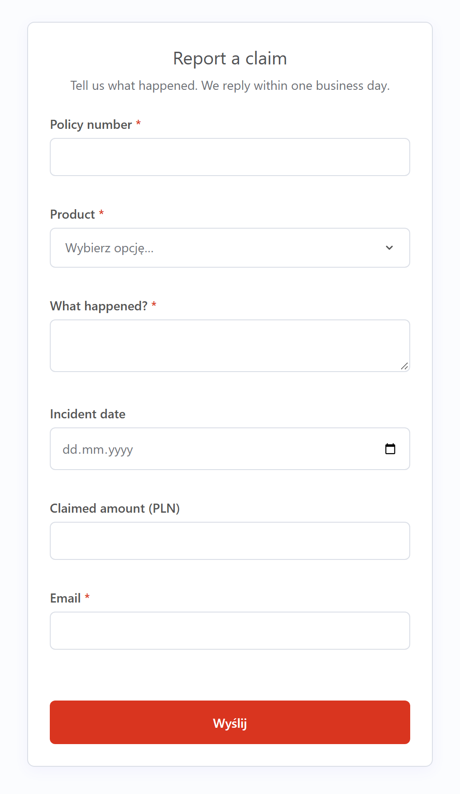
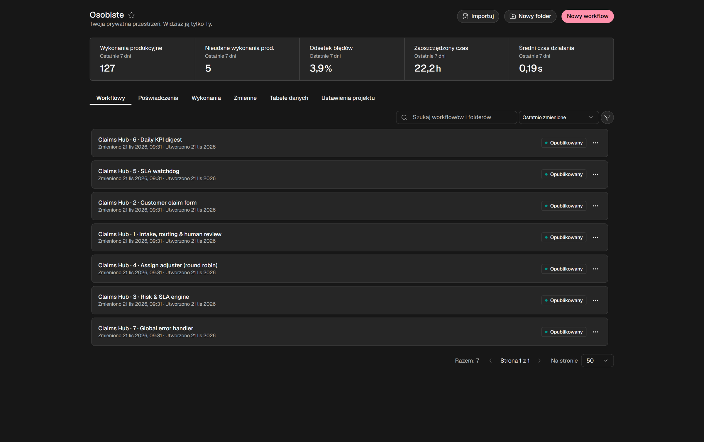
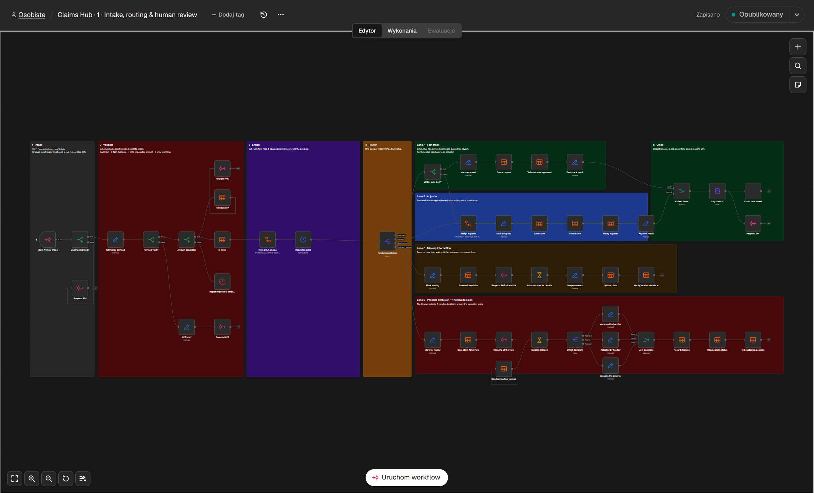

# Claims Operations Hub — a multi-workflow automation built in Solvon

The back office behind the [AI claims assistant](../claims-assistant/): the assistant triages a claim, Solvon runs
the business process around it — validation, routing, adjuster assignment, waiting for customers and handlers,
SLA escalation, daily reporting and incident handling.

**7 workflows · 102 working nodes · 25 node types · 7 data tables**, all running on a local Solvon instance and
driven by real traffic (see [Run it yourself](#run-it-yourself)).



<sub>Workflow 1 on the Solvon canvas: coloured sections are sticky notes, every box is a node.</sub>

## How it fits together



| # | Workflow | Trigger | What it demonstrates |
|---|---|---|---|
| 1 | **Intake, routing & human review** (50 nodes) | Webhook `POST /webhook/claims-hub/intake` | Shared-secret header (`X-Hub-Token` vs. the project variable `HUB_TOKEN`) → `401`; schema and amount validation (`0 ≤ payout ≤ amount`, NaN rejected) → `422`; duplicate check against a Data Table → `409`; implausible amount → `Stop and Error` → error workflow; enrichment through a sub-workflow; a `Switch` router with four lanes; `Respond to Webhook` with a tracking id; **two human-in-the-loop lanes** that answer `202` immediately and then **wait for a form** (customer details / handler decision) before continuing |
| 2 | **Customer claim form** | Public Form Trigger | Multi-field form, completeness check, same risk engine, confirmation page with the claim number |
| 3 | **Risk & SLA engine** | Execute Workflow Trigger | Rule-based risk score with expressions (regex, Luxon date maths), priority `Switch`, SLA hours, due date with Date & Time |
| 4 | **Assign adjuster** | Execute Workflow Trigger | Round robin: load active adjusters with the right skill, `Sort` by open tasks, `Limit 1`, book the workload, `Merge` the assignee back onto the claim |
| 5 | **SLA watchdog** | Schedule, hourly | Find overdue open tasks, `Split in Batches` loop of 5, mark escalated, page the team lead, one digest per run |
| 6 | **Daily KPI digest** | Schedule, cron `0 7 * * *` | Two `Summarize` branches in parallel (per lane and totals), `Merge` + `Aggregate`, KPI row, management digest, time saved for Insights |
| 7 | **Global error handler** | Error Trigger | Set as the error workflow of 1–6: incident log and an on-call alert |

Messages to customers, adjusters and on-call go to an `outbox` table: one place that a mail or chat sender reads
from, so every notification is also auditable.



## It actually runs

The screenshots come from a real run, `traffic.py` + `resume.py` against a local instance:

- **20 claims** triaged by the claims assistant and posted to the webhook → 7 fast track, 9 adjuster, 1 missing
  information, 3 possible exclusions;
- **edge cases**: no token → `401`, invalid payload or a negative amount → `422`, resent claim → `409`, a 9,000,000 PLN claim → error → incident logged by
  workflow 7;
- **humans in the loop**: 3 handler decisions (reject / send to adjuster / approve) and 1 customer reply submitted
  through the waiting forms, after which the paused executions finished;
- **2 public form** submissions (one complete, one missing data);
- **SLA watchdog**: 3 of 12 open tasks overdue → escalated in a batch loop; **KPI digest**: one report row.

| Execution of a human-review claim (lane D) | Data Table with every claim |
|---|---|
|  |  |
| **Outbox: notifications produced by the flows** | **Insights: executions, failure rate, time saved** |
|  |  |

<p align="center"></p>

## Run it yourself

Needs a Solvon instance (the product is private) and Python 3.12 with `httpx` plus the claims assistant
(`pip install -e claims-assistant`), which `traffic.py` uses to triage each claim:

```bash
# automations/.env.local:  SOLVON_URL  SOLVON_API_KEY  SOLVON_PROJECT_ID  SOLVON_EMAIL  SOLVON_PASSWORD
# (deploy.py generates HUB_TOKEN on first run and stores it as a Solvon project variable)
# (the e-mail/password are used by traffic.py to start the two scheduled workflows once)
python automations/deploy.py              # create 7 tables + 7 workflows, publish, export JSON
python automations/traffic.py             # AI-triaged claims, edge cases, backlog, scheduled runs
python automations/resume.py              # answer the waiting forms like a handler / customer
python automations/deploy.py --update     # re-render and PUT in place (keeps executions and data)
```

- [`hub.py`](hub.py) — every workflow defined in Python with a small builder (nodes, connections, coloured sections),
  so the whole system is reviewable as code;
- [`deploy.py`](deploy.py) — Solvon public REST API: data tables, workflows, publish, export, in-place updates;
- [`workflows/`](workflows/) — the exported workflows in the n8n-compatible JSON format, for reading; they contain
  instance-specific ids (tables, sub-workflows), so install the hub with `deploy.py`, which wires the ids itself.

## Design choices

- **AI outside, process inside.** The language-model step lives in a separate, tested Python service; the workflow
  engine owns the process, the data and the waiting. The webhook is the contract between them.
- **The AI never decides alone.** Possible exclusions always stop for a human, and the decision is recorded.
- **Fail loudly.** Bad input gets a clear 4xx; anything unexpected goes to one error workflow and an incident row.
- **Capabilities stay internal.** The intake webhook requires a shared secret (`X-Hub-Token`, checked against the
  project variable `HUB_TOKEN`). A handler's review link resumes a paused execution, so it is never returned to the
  caller — it goes to the internal claims desk through the outbox. The customer's own form link is returned,
  because the caller passes it to that customer.

<table>
  <tr>
    <td></td>
    <td></td>
  </tr>
  <tr>
    <td align="center"><sub>All seven workflows published in one project</sub></td>
    <td align="center"><sub>The main workflow in the editor</sub></td>
  </tr>
</table>
